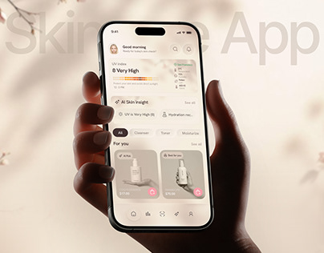

# Skincare UV App in Hand with Blossoms

**Discipline:** app ·  · **Design style:** Warm & Organic
**Tags:** skincare, cream, blossom, hand, ghost-type, uv-index, cover

## What it is
A soft cream cover with cherry blossom branches in the corners, giant faint 'Skincare App' lettering and a dark hand holding a phone showing a UV index, an AI skin insight card and product cards with pink buttons.

## What it means
Blossoms and cream evoke gentle skincare, and the dark hand gives strong contrast to the pale UI.

## Techniques
- Blossom branches framing the top corners
- Ghost lettering behind the phone
- Dark hand against pale scene
- Warm cream and blush UI colours
- Rainbow UV bar as a small data graphic

## Best for
- Skincare and beauty apps
- Soft cream covers
- Nature-themed app hero shots

## Vocabulary
- **Botanical frame** — Plants or blossoms placed at the corners of a scene.
- **UV index bar** — A gradient bar showing sun exposure level.
- **Insight chip** — A small pill delivering an AI tip.
