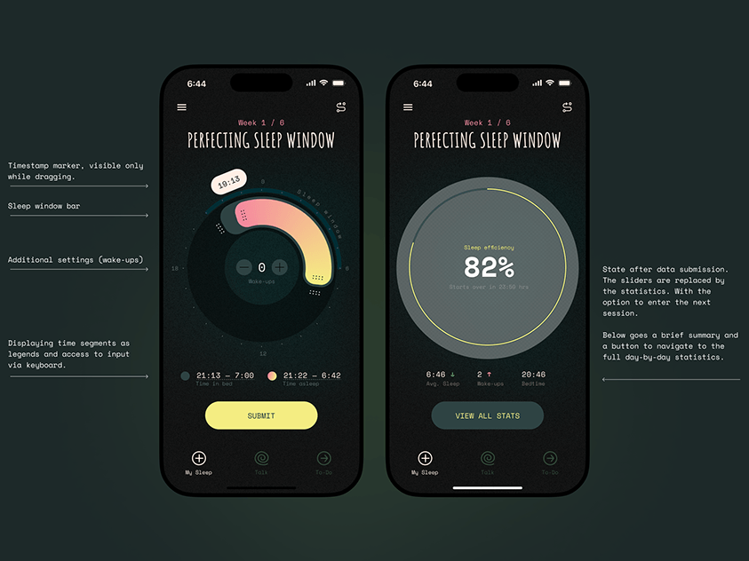

# Dark sleep-window dial with pink-to-yellow arc, condensed serif title and side annotations

**Discipline:** app ·  · **Design style:** Neo-Brutalist
**Tags:** sleep, dark-green, dial, gradient-arc, annotations, monospace, condensed-serif, yellow-button

## What it is
Two phones on dark green: one with a circular clock dial where a peach-to-pink arc marks the sleep window and a floating time marker, one showing 82% sleep efficiency in a grey ring. Monospace annotations with leader lines describe each element, and a yellow Submit pill sits at the bottom.

## What it means
Precise and moody; the arc turns time into a tactile object.

## Techniques
- Represent time as a thick gradient arc on a dial.
- Annotate the UI with monospace notes and leader lines.
- Use a condensed serif for the screen title.
- Reserve a single yellow pill for the action.

## Best for
- Sleep and habit apps
- Interaction explainer slides
- Dark UI with annotation

## Vocabulary
- **Dial arc** — A ring segment showing a time range.
- **Annotation callout** — A note connected to a UI part by a line.
- **State pair** — Two screens showing before and after.
- **Condensed serif** — A narrow serif used for titles.
