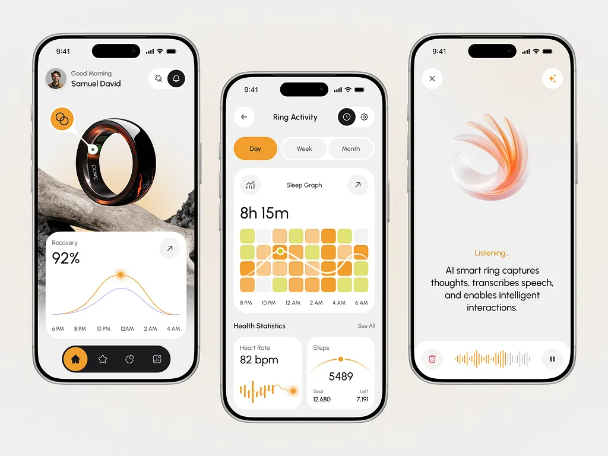

# Smart ring health app in cream with orange heatmap and voice orb

**Discipline:** app ·  · **Design style:** Warm & Organic
**Tags:** wearable, health, orange, cream, heatmap, waveform, voice-ai, phones

## What it is
Three phones on cream: a home with a photo of a ring on driftwood and a recovery curve card, a sleep heatmap grid in orange-to-lime with a wave overlay and stat cards, and a voice screen with a translucent orange swirl and waveform.

## What it means
Warm, calm and premium; orange on cream feels energising without clinical coldness.

## Techniques
- Show sleep data as a grid of rounded squares graded from orange to green.
- Overlay a smooth wave line on the heatmap.
- Use a translucent 3D swirl as the voice assistant emblem.
- Pair a real product photo with a chart card.
- Use a dark pill tab bar with an orange active state.

## Best for
- Wearables and health tracking apps
- AI voice features
- Warm consumer health brands

## Vocabulary
- **Heatmap grid** — A grid of cells coloured by value.
- **Waveform** — A graphic of audio amplitude bars.
- **Swirl emblem** — A translucent 3D shape representing an AI.
- **Active pill tab** — A selected tab shown as a coloured capsule.
