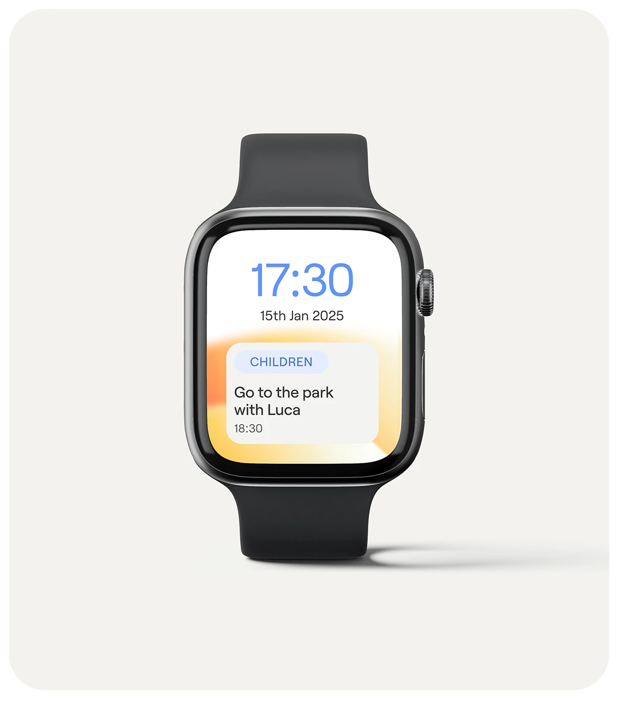

# Smartwatch Reminder Glance

**Discipline:** app · **Design type:** Wearable UI
**Tags:** smartwatch, reminder, cream, orange, blue, minimal, glance

## What it is
A black smartwatch centered on a warm cream rounded panel showing a huge blue clock, date and a reminder card over an orange-yellow gradient.

## What it means
Very few elements and large type suit a glance-sized screen. Warm gradient makes a small screen feel friendly.

## Techniques
- Huge time as the primary element for glanceability
- Category chip above a short reminder sentence
- Warm gradient glow behind the card only
- Product shot centered with a soft shadow
- Neutral panel that lets the watch pop

## Best for
- Wearable interface design
- Calendar and reminder apps
- Minimal product presentations

## Vocabulary
- **Glanceable UI** — An interface readable in a second at a distance or on a tiny screen.
- **Category chip** — A small pill naming a type of item.
- **Soft floor shadow** — A diffuse shadow beneath an object to ground it.
