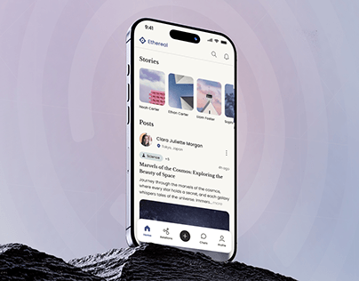

# Social Feed Phone on Dark Rock

**Discipline:** app · **Design type:** Device mockup scene
**Tags:** social, rock, halo, pastel, serif, stories, cover

## What it is
A cover with a phone showing a light social feed with story tiles and a serif article post, standing on a dark rocky peak against a pale pink and lilac ring gradient.

## What it means
A dark rock base grounds the airy pastel scene, and concentric rings add a calm halo.

## Techniques
- Dark rock base against pastel sky
- Concentric ring halo behind the phone
- Serif type in the UI for an editorial feel
- Story tiles with architectural images
- Phone rising from the base

## Best for
- Editorial and community apps
- Pastel gradient covers
- Product on natural base

## Vocabulary
- **Ring halo** — Concentric rings radiating behind a subject.
- **Story tile** — A small rounded image at the top of a feed.
- **Editorial UI** — An interface using serif type and article layouts.
