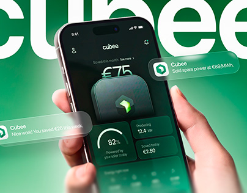

# Green energy app held in a hand with floating glass notifications over a huge white wordmark

**Discipline:** app · **Design type:** Device mockup scene
**Tags:** energy, green, hand, glass-notifications, giant-wordmark, gradient, mockup, project-cover

## What it is
A green gradient with a giant white cropped 'cubee' behind, a hand holding a phone whose dark green UI shows a savings figure, an app icon, a gauge, and stats. Frosted glass notification cards float outside the phone.

## What it means
Fresh and smart; green glow and glass alerts say clean energy and instant feedback.

## Techniques
- Put a huge cropped wordmark behind the device.
- Float glass notifications beside the phone.
- Keep the palette in green tones.
- Show a savings number as the hero.

## Best for
- Energy and sustainability apps
- Project covers with notification storytelling
- Green tech brands

## Vocabulary
- **Glass notification** — A translucent alert card outside the phone.
- **Cropped wordmark** — A giant brand name cut by the frame.
- **Hero number** — A single big figure as focal point.
- **Tonal green** — A palette of many greens.
