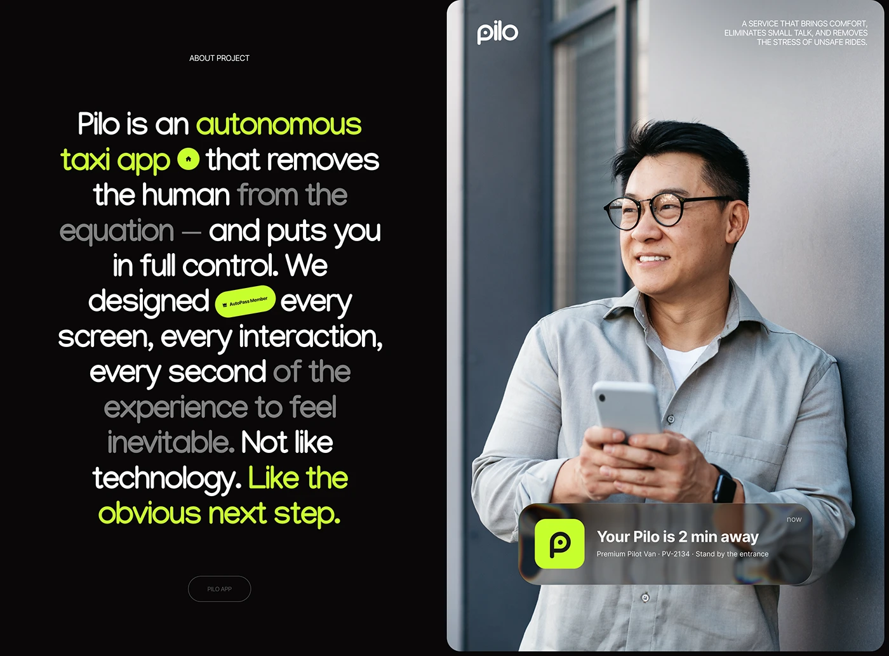

# Dark manifesto paragraph with lime highlights beside a portrait and notification

**Discipline:** app ·  · **Design style:** Photographic & Cinematic
**Tags:** case-study, dark, lime, manifesto, notification, portrait, variable-emphasis

## What it is
A split slide: left, a black panel with a centred paragraph in large rounded type where key phrases are lime and some are dimmed grey; right, a rounded photo of a man leaning on a wall with a phone, a frosted notification card 'Your Pilo is 2 min away' and the logo.

## What it means
Confident and narrative; the alternating emphasis guides how the paragraph is read.

## Techniques
- Vary text opacity and colour within one paragraph to create emphasis and rhythm.
- Embed tiny pill badges inside the text as inline illustrations.
- Overlay a frosted notification card on a photo to show the product moment.
- Split the layout into a text side and a photo side with a rounded image.

## Best for
- Project intros in case studies
- Mission or manifesto slides
- Brands with a bold tech voice

## Vocabulary
- **Emphasis gradient** — Text where some words are bright and others dimmed.
- **Inline badge** — A small pill placed within a line of text.
- **Notification card** — A frosted rectangle mimicking a phone alert.
- **Manifesto paragraph** — A long statement of purpose set as a graphic.
