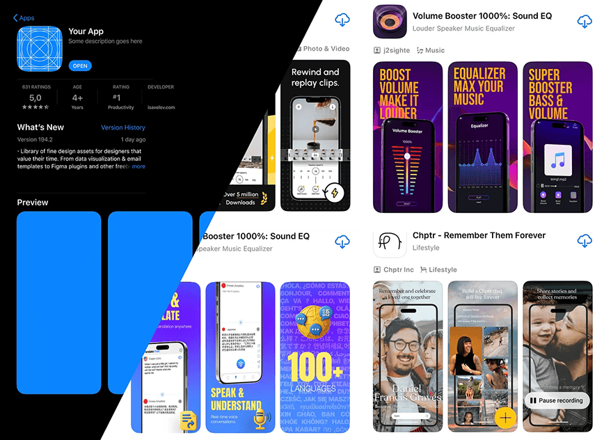

# App Store listing screenshots in bold poster styles

**Discipline:** app · **Design type:** App store presentation
**Tags:** app-store, screenshots, marketing, purple-orange, photography, diagonal-split, listing

## What it is
A diagonal-split collage of App Store pages: a dark 'Your App' template with blue placeholder screenshots, and listings with vibrant screenshot posters such as purple and orange sound equalizers, a translation app with a rainbow globe, and a photo-led memory app.

## What it means
Shows how the listing itself is a design surface; big headlines in screenshots sell before anyone reads.

## Techniques
- Turn each screenshot into a mini poster with a bold headline above a phone.
- Use a consistent gradient background across a screenshot set.
- Mix illustration, real photography or 3D depending on the app's voice.
- Use a diagonal cut to compare styles.

## Best for
- App store marketing design
- Growth and product marketing teams
- Comparing visual approaches

## Vocabulary
- **Store screenshot** — A marketing image displayed in an app listing.
- **Headline-over-device** — Big text above a phone in a screenshot.
- **Listing page** — The store page describing an app.
- **Diagonal split** — Two areas divided by an angled line.
