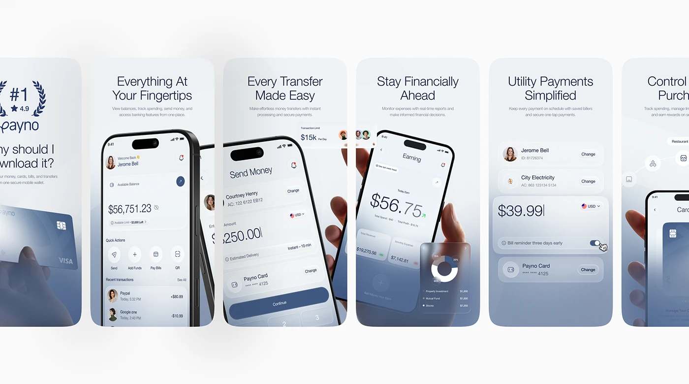

# Six frosted-glass store screenshots: #1 laurel, home, send money, earning, utility payments and controls

**Discipline:** app · **Design type:** App store presentation
**Tags:** app-store, screenshots, fintech, pearl-blue, glass, serif-numerals, hand, laurel

## What it is
A row of tall rounded screenshot cards on white with pearl blue gradients, each with a light two-line headline and small subline over a phone or UI fragment: a #1 laurel and a hand with a card, a home screen, a send-money keypad, a hand-held earning screen with a donut chart card, a bill reminder toggle card and a partial controls view.

## What it means
Airy and reassuring; frosted cards and hands make each feature feel tangible.

## Techniques
- Give each screenshot a frosted card and short headline.
- Mix full phones with cropped UI fragments.
- Include hands for scale.
- Keep one pearl-blue gradient.

## Best for
- Fintech store listings
- Glass screenshot sets
- Feature-per-card presentations

## Vocabulary
- **Screenshot card** — A rounded card holding one store image.
- **UI fragment** — A cropped piece of interface as illustration.
- **Laurel badge** — A wreath around a rank or rating.
- **Toggle reminder** — A settings switch shown as a feature.
