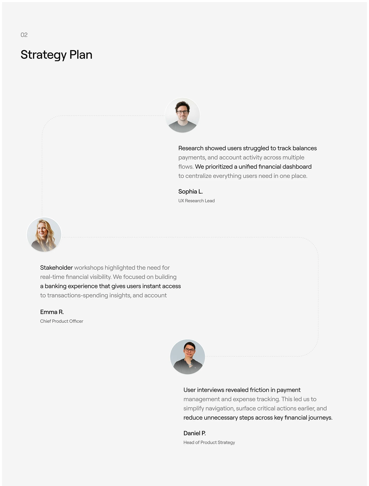

# Strategy plan slide linking round portraits along a dashed path with quoted findings

**Discipline:** app ·  · **Design style:** Photographic & Cinematic
**Tags:** strategy, process, grey, avatars, dashed-path, two-tone-text, research, case-study

## What it is
A light grey slide numbered 02 with a large title. Three circular portraits sit at staggered points on a faint dashed line that bends between them; beside each, a paragraph with black key phrases and grey secondary text, followed by a name and role.

## What it means
Human and calm; the path suggests a conversation moving between contributors.

## Techniques
- Connect portraits with a dashed rounded path.
- Highlight key phrases in black inside grey text.
- Stagger blocks left and right to zigzag down the page.
- Keep names and roles small under each paragraph.

## Best for
- Strategy and stakeholder summaries
- Research findings by contributor
- Minimal light case studies

## Vocabulary
- **Dashed path** — A dotted line linking elements in sequence.
- **Key-phrase contrast** — Dark words within grey text for emphasis.
- **Zigzag layout** — Alternating left and right placement.
- **Attribution line** — Name and role below a statement.
