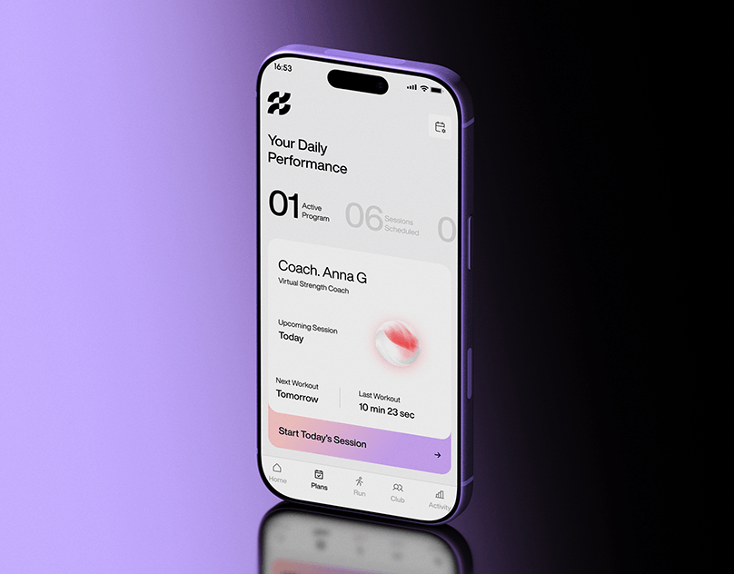

# Coach app on a lilac-to-black floor with reflective gradient

**Discipline:** app ·  · **Design style:** Gradient & Aurora
**Tags:** fitness, coach, lilac, black, gradient, reflection, white-ui, large-numerals

## What it is
A tilted purple phone on a glossy surface reflecting it, against a lilac to black gradient. The screen is light grey with a heading, big '01' and '06' counters, a card for a virtual coach with a pink-red 3D glove, session times, and a pale purple start button.

## What it means
Sleek and athletic; the reflection and gradient make the app feel like a premium product.

## Techniques
- Place the device on a glossy floor with a mirror reflection.
- Blend from lilac to black behind the device.
- Show counters as huge light numerals with tiny captions.
- Use a pastel gradient button as the primary action.

## Best for
- Fitness and coaching apps
- Premium product shots
- Dark-to-light gradient presentations

## Vocabulary
- **Floor reflection** — A mirrored copy of an object on a shiny surface.
- **Counter numerals** — Very large numbers used as key indicators.
- **Gradient CTA** — A button filled with a soft gradient.
- **Virtual coach card** — A card presenting an AI or digital trainer.
