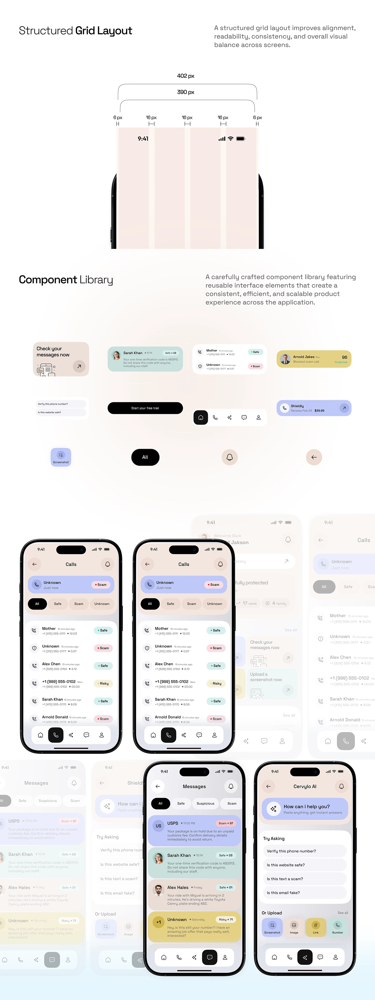

# Structured Grid and Component Library Sheet

**Discipline:** app · **Design type:** Design system documentation
**Tags:** grid, components, library, peach, pastel, screens, fade, long-sheet

## What it is
A tall pale sheet with a Structured Grid Layout section showing a phone width with 6px and 16px margins and gutters over peach columns, a Component Library section of pastel cards, chips and buttons, and rows of phone screens fading out to the sides.

## What it means
Showing the grid dimensions and components with fading screens conveys a system that scales, in a friendly pastel palette.

## Techniques
- Grid columns drawn over a phone silhouette with measurements
- Components floating on white
- Screens fading toward the edges
- Soft pastel status colours
- Two-column headings with descriptions

## Best for
- Design-system documentation
- Grid and component overviews
- Pastel UI systems

## Vocabulary
- **Gutter** — The space between columns.
- **Component library** — A set of reusable interface elements.
- **Edge fade** — Items fading out at the edges of a layout.
