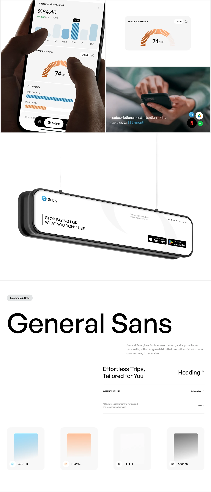

# Subscription Tracker Long-Scroll Showcase

**Discipline:** app ·  · **Design style:** Gradient & Aurora
**Tags:** subscriptions, long-scroll, orange, blue, typography, lightbox, white

## What it is
A tall white case-study page: hands using a subscription-spend chart, a subscription-health gauge tile, a photo card with logos, a hanging lightbox sign 'Stop paying for what you don't use', and a General Sans typography specimen with four gradient colour swatches.

## What it means
Mixing close-up hands, an ad mockup and a system page shows product, marketing and identity in one coherent white and orange world.

## Techniques
- Orange segmented gauge as the signature chart
- Hatched blue bars with a highlighted day
- Suspended lightbox ad for a real-world touchpoint
- Huge specimen name in black with a smaller type hierarchy below
- Gradient swatches with pastel cards

## Best for
- Fintech and subscription apps
- Long-scroll case studies
- Identity plus product showcases

## Vocabulary
- **Segmented gauge** — A semicircle made of radial dashes.
- **Hanging lightbox** — An illuminated ad panel suspended by cables.
- **Type hierarchy sample** — A demo of heading, subheading and body sizes.
