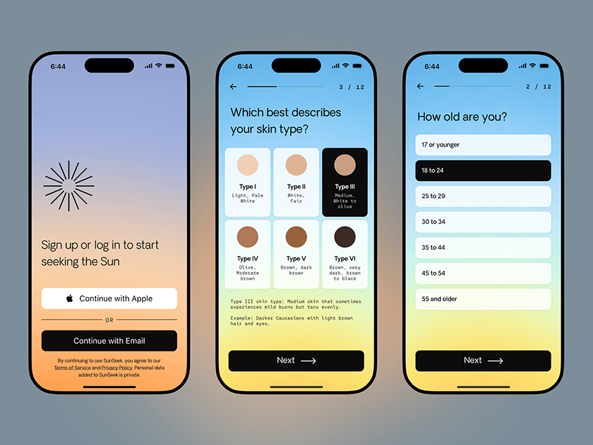

# Onboarding screens on sunset-to-sky gradients with skin-tone swatches

**Discipline:** app ·  · **Design style:** Neo-Brutalist
**Tags:** onboarding, gradient, sun, forms, skin-type, black-buttons, monospace, health

## What it is
Three phones in a row: a peach-to-lilac sign-up with a sunburst icon and Apple/Email buttons; a blue-to-yellow questionnaire with six skin-tone swatch cards and monospace descriptions; and a list of age options with the selected one in black.

## What it means
Warm, open and reassuring; the sun-inspired gradients make a personal questionnaire feel gentle.

## Techniques
- Use a full-screen sunrise gradient as the background of a sign-in screen.
- Show skin-tone options as coloured circles in tappable cards.
- Highlight the selected option by inverting to black.
- Add a step counter and back arrow to show progress.
- Use monospace text for descriptors.

## Best for
- Health and sun-safety apps
- Questionnaire and onboarding flows
- Apps needing an inclusive, friendly tone

## Vocabulary
- **Sunrise gradient** — A gradient moving from warm orange through yellow to blue.
- **Swatch card** — A tappable card with a colour sample.
- **Inverted selection** — Selected state shown as black fill with white text.
- **Step counter** — Shows progress like 3 / 12.
