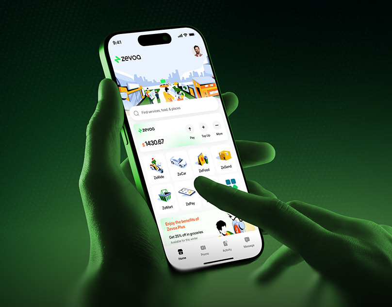

# Super-app home screen held in green-lit hands

**Discipline:** app · **Design type:** Device mockup scene
**Tags:** super-app, green, monochrome-photo, hands, dark-gradient, illustration, service-grid

## What it is
Two hands, tinted deep green, hold a phone showing a white super-app home screen with an illustrated city header, a search bar, a balance card and a grid of illustrated service tiles (ride, car, food, send, mart). The background is a green radial gradient into black.

## What it means
Vibrant and modern; the monochrome green scene makes the bright screen the only light source.

## Techniques
- Tint the photo of hands in the brand colour so the screen glows.
- Use a dark radial gradient to focus attention.
- Give service tiles colourful isometric illustrations.
- Pair a big balance card with quick actions (pay, top up).

## Best for
- Super-apps, payments and delivery apps
- App launch visuals
- Brand-coloured photographic mockups

## Vocabulary
- **Monochrome tint** — Colouring a photo in one hue.
- **Service grid** — A grid of illustrated shortcuts.
- **Radial vignette** — A glow that fades to dark at the edges.
- **Isometric icon** — An icon drawn from a 3D angle.
