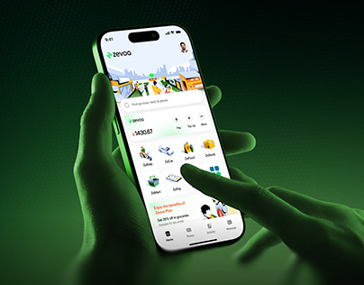

# Super-app green-lit hands, square project thumbnail crop

**Discipline:** app · **Design type:** Device mockup scene
**Tags:** super-app, green, thumbnail, hands, monochrome-photo, project-cover

## What it is
A square-cropped version of the green-tinted hands holding a phone with a service-grid home screen, made as a portfolio thumbnail.

## What it means
Reads instantly at small size: the glowing screen and green hands are a strong, simple focal point.

## Techniques
- Crop a mockup to a square with the device centred for portfolio grids.
- Keep a single colour cast for one-glance recognition.
- Leave dark space around the phone to let it glow.
- Use a bright screen against a dark scene to survive downsizing.

## Best for
- Behance and Dribbble covers
- Portfolio grids
- Social previews of app projects

## Vocabulary
- **Project cover** — A thumbnail representing a whole project.
- **Thumbnail crop** — A recomposed version for small sizes.
- **Colour cast** — A single dominant tint over an image.
- **Glow focus** — Using a bright screen to draw the eye.
