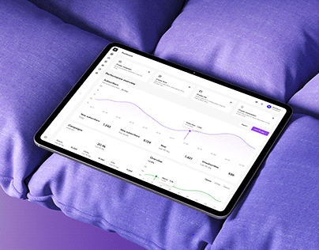

# Analytics tablet resting on puffy violet cushions

**Discipline:** app · **Design type:** Device mockup scene
**Tags:** mockup, tablet, 3d-scene, violet, soft-textile, analytics, playful-luxury

## What it is
A tablet with a light analytics dashboard lies on quilted violet fabric cushions, lit softly, with a purple gradient at the corner.

## What it means
Soft, comfortable and surprising; the plush fabric makes a data tool feel friendly.

## Techniques
- Set a functional screen on an unexpected soft material to create contrast.
- Match the environment to the UI's accent colour (violet) for cohesion.
- Photograph at an angle with shallow depth so the screen recedes naturally.
- Keep the UI light so it glows against the saturated scene.

## Best for
- Analytics and marketing tool launches
- Brands wanting approachable data
- Social preview images for products

## Vocabulary
- **Environmental mockup** — Placing a UI in a stylised physical scene.
- **Tonal scene** — A scene composed in a single hue family.
- **Material contrast** — Pairing a hard technical object with a soft texture.
- **Shallow depth** — Blur in foreground and background to focus on the subject.
