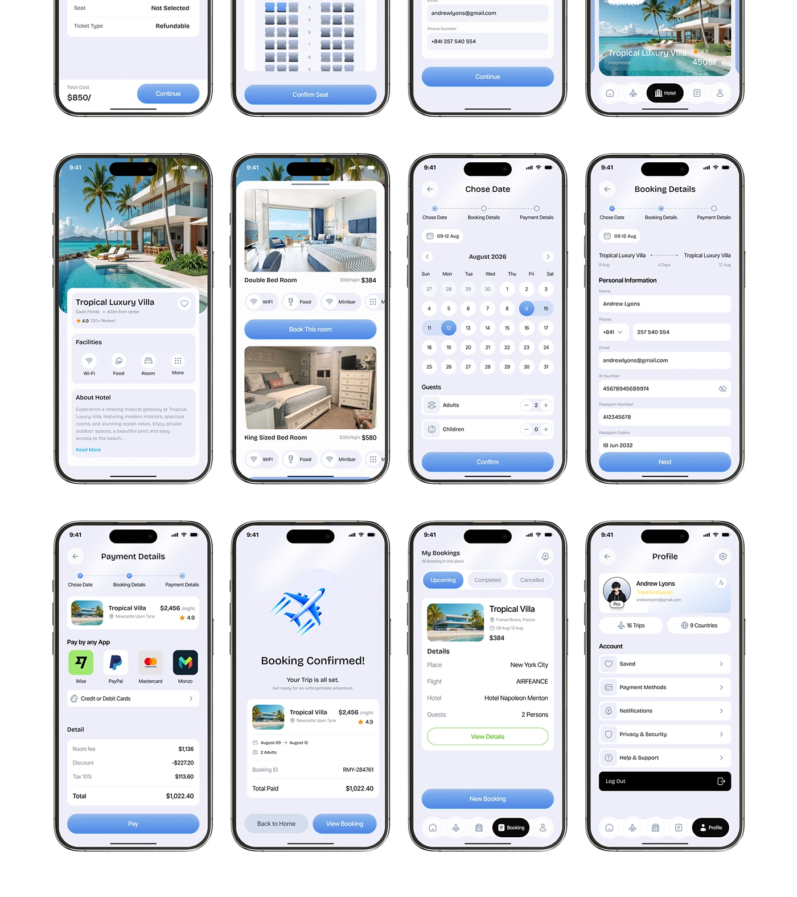

# Twelve-Screen Hotel Booking Flow Sheet

**Discipline:** app ·  · **Design style:** Gradient & Aurora
**Tags:** screen-sheet, hotel, booking, lavender, blue, payment, profile

## What it is
A lavender sheet of twelve phones in three rows, the top row cropped: hotel detail, room list, date picker, booking details form, payment details, booking confirmed, my bookings and profile, all in soft blue and white with rounded cards.

## What it means
A dense grid with a cropped top row shows how far the flow goes, and the constant blue keeps it unified.

## Techniques
- Cropped top row implying more screens
- Uniform grid of identical bezels
- Blue gradient primary buttons on every screen
- Step tracker on each form screen
- Black active pill in the tab bar

## Best for
- Full booking flow documentation
- Hotel and travel apps
- Screen-grid portfolio pages

## Vocabulary
- **Cropped row** — A row of screens cut off at the edge to imply more.
- **Step tracker** — Dots and labels showing progress through a flow.
- **Active pill** — A black highlighted item in a tab bar.
