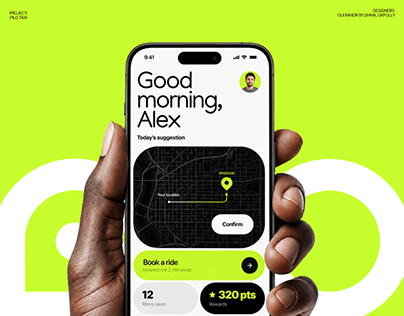

# Ride app home screen in a hand over giant lime letterforms

**Discipline:** app · **Design type:** Device mockup scene
**Tags:** mobility, lime, hand, mockup, giant-letters, map-card, rewards

## What it is
A lime cover with big paler rounded letters of the brand name behind a phone held by a dark hand. The screen has a large 'Good morning, Alex', a black map card with route and confirm button, a lime 'Book a ride' bar and a rewards stat.

## What it means
Friendly and energetic; the greeting adds warmth to a utilitarian app.

## Techniques
- Use oversized tone-on-tone letters as a backdrop.
- Contrast a black map card with lime buttons.
- Start the screen with a personal greeting in huge type.
- Hold the phone in a hand to add life.

## Best for
- Mobility and delivery apps
- Case-study covers with strong colour
- Consumer apps needing warmth

## Vocabulary
- **Tone-on-tone type** — Large letters slightly different in shade from their background.
- **Greeting header** — A friendly personalised heading at the top of a screen.
- **Map card** — A dark card showing a route within a screen.
- **Reward chip** — A small stat showing points.
