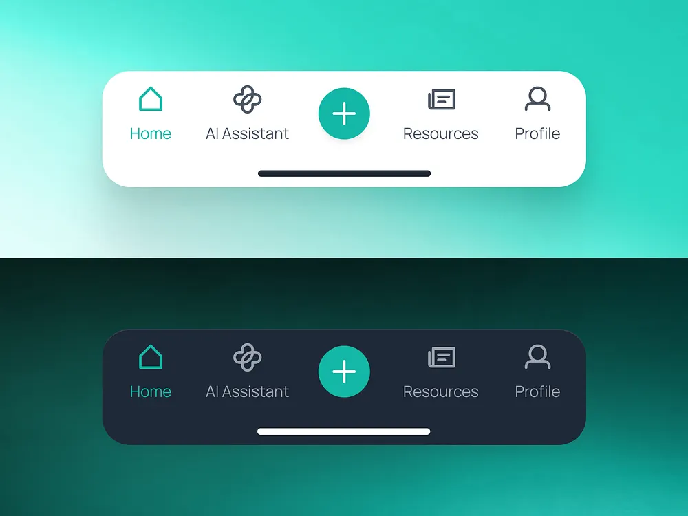

# Teal Bottom Navigation with Centre Plus

**Discipline:** app ·  · **Design style:** Gradient & Aurora
**Tags:** bottom-nav, teal, light-dark, fab, ai-assistant, gradient-backdrop, icons

## What it is
Two versions of a five-item bottom navigation (Home, AI Assistant, centre plus, Resources, Profile) with teal active and centre button, the top on white over a mint gradient and the bottom on dark navy over a deep teal gradient, each with a home indicator bar.

## What it means
The same teal accent works in light and dark, and the centre plus button gives a clear primary action.

## Techniques
- Light and dark versions stacked
- Teal active tab and centre button
- Centre plus button as the main action
- Icons with labels beneath
- Gradient backdrop matched to the theme

## Best for
- Mobile navigation components
- Light and dark theme demonstrations
- Apps with a primary create action

## Vocabulary
- **Centre action button** — A prominent button in the middle of a tab bar.
- **Home indicator** — The thin bar at the bottom of an iPhone screen.
- **Theme stack** — Light and dark versions shown one above the other.
