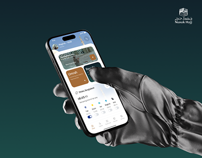

# Silver Gloved Hand with Pilgrimage App

**Discipline:** app ·  · **Design style:** Gradient & Aurora
**Tags:** teal, glove, silver, gradient, religion, cover, hand

## What it is
A cover on a dark teal gradient with a metallic silver gloved hand holding a phone showing an app with cream and brown cards and prayer times, and an Arabic-and-English logo at top right.

## What it means
The chrome glove is a striking surreal touch that makes a devotional app feel premium.

## Techniques
- Metallic glove as a surreal prop
- Deep teal gradient background
- Warm brown card as accent on light UI
- Logo placed in the top corner
- Finger poised to tap

## Best for
- Faith and cultural apps
- Surreal hero covers
- Premium mobile branding

## Vocabulary
- **Surreal prop** — An unexpected object added for visual impact.
- **Chrome render** — A reflective metallic 3D look.
- **Tap moment** — A finger about to touch the screen.
