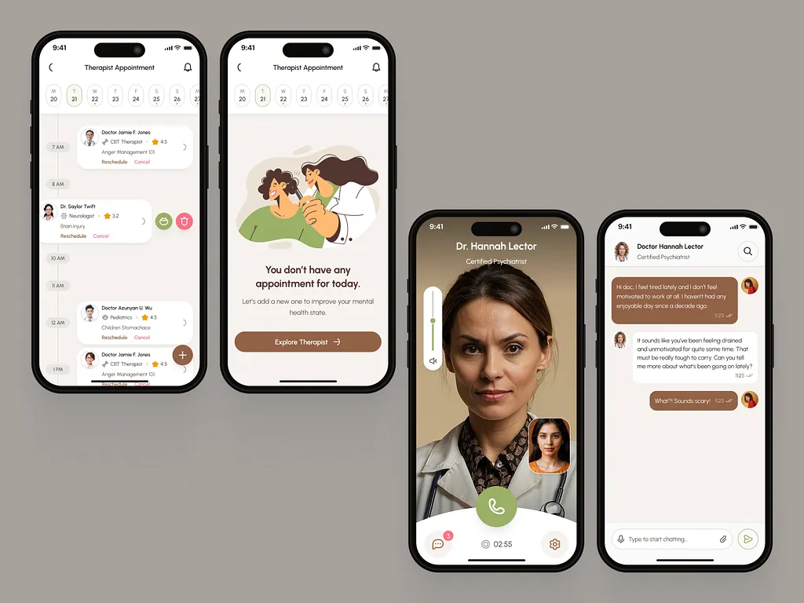

# Four warm-neutral screens: therapist schedule, empty-state illustration, video call and chat, with olive and brown accents

**Discipline:** app · **Design type:** Health app screens
**Tags:** mental-health, warm-neutral, olive, brown, empty-state, video-call, chat, phones

## What it is
Four black-bezel phones on greige: an appointment timeline with a week strip, doctor cards with ratings, reschedule and cancel links and a brown plus button; an empty state with a flat illustration of a therapist and patient and 'You don't have any appointment for today.' with a brown button; a video call with a full-screen portrait, a self-view tile and a large olive call button; and a chat with brown and white bubbles.

## What it means
Calm and humane; warm neutrals with olive feel safe for mental-health care.

## Techniques
- Use olive and brown instead of clinical blue.
- Add a flat illustration to an empty state.
- Round every card and bubble.
- Use a big circular action button in calls.

## Best for
- Mental health and telehealth apps
- Warm neutral palettes
- Appointment and chat flows

## Vocabulary
- **Empty-state illustration** — A drawing shown when a list has no items.
- **Week strip** — A row of day pills at the top.
- **Self-view tile** — A small video of yourself during a call.
- **Chat bubble** — A rounded message container.
