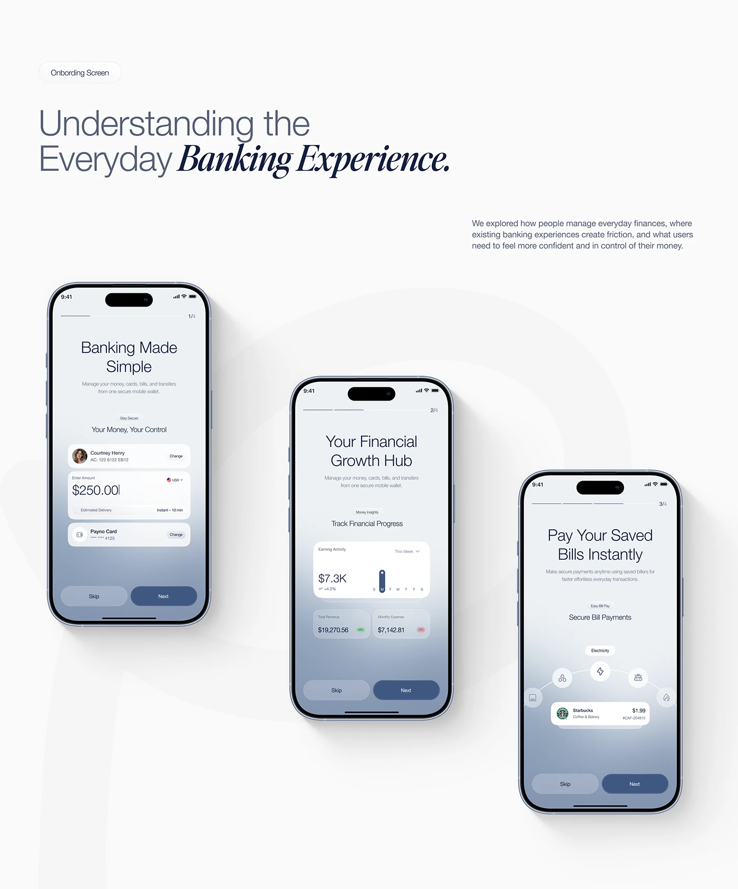

# Three Fintech Onboarding Screens Staggered

**Discipline:** app · **Design type:** Onboarding screens
**Tags:** onboarding, fintech, blue-grey, serif-italic, staggered, gradient, progress

## What it is
A white page with an Onboarding Screen pill, a headline mixing light sans and bold italic serif 'Banking Experience.', a paragraph, and three phones staggered diagonally down the page showing Banking Made Simple, Your Financial Growth Hub and Pay Your Saved Bills Instantly, each with a blue-grey gradient, cards and Skip and Next buttons.

## What it means
A diagonal stagger gives a sequence rhythm, and the same gradient and buttons hold the three steps together.

## Techniques
- Diagonal stagger of three phones
- Blue-grey gradient rising from the base of each screen
- Skip and Next button pair on each screen
- Step counters at the top right
- Arc of icons for bill types

## Best for
- Onboarding flow presentations
- Fintech app case studies
- Diagonal screen sequences

## Vocabulary
- **Diagonal stagger** — Items placed along a diagonal path.
- **Skip/Next pair** — A secondary and primary button at the base of onboarding.
- **Step counter** — A fraction such as 2/4 showing onboarding progress.
