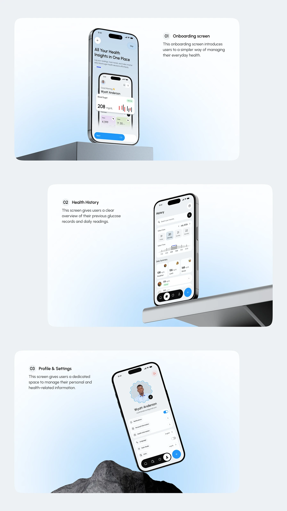

# Three Health Screens on Plinths with Descriptions

**Discipline:** app ·  · **Design style:** 3D & Surreal
**Tags:** health, onboarding, history, profile, plinth, pale-blue, descriptions

## What it is
A pale page of three rounded panels, each with a numbered caption and a phone on a grey plinth or ledge: onboarding, health history and profile & settings, with the phone tilted differently in each.

## What it means
Varying the tilt and prop in each panel keeps a repetitive sequence lively, and short captions explain each screen.

## Techniques
- One panel per screen with a numbered caption
- Different plinth and rock props per panel
- Alternating text left and right
- Soft blue gradient inside each panel
- Phone tilted at a new angle each time

## Best for
- Screen-by-screen documentation
- Health app case studies
- Rhythmic vertical layouts

## Vocabulary
- **Screen panel** — A rounded panel presenting one screen with a caption.
- **Alternating layout** — Text and image swapping sides down the page.
- **Prop variation** — Changing the scene object to keep repeated shots fresh.
