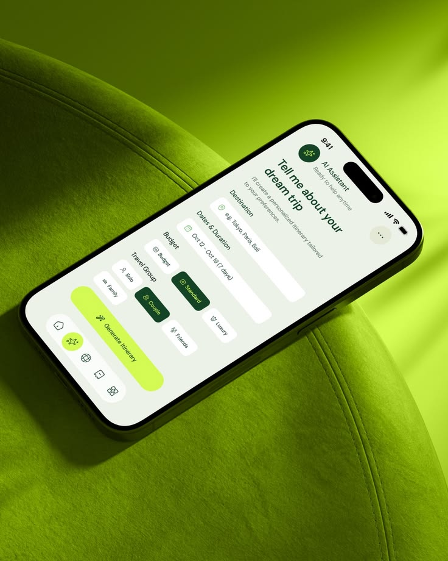

# Tilted Phone on Lime Velvet

**Discipline:** app ·  · **Design style:** 3D & Surreal
**Tags:** lime, green, monochrome, 3d, travel, ai, tilted-phone

## What it is
A phone showing a travel planner form tilted diagonally across a curved lime-green velvet form, with a lime-and-forest-green interface that matches the surroundings.

## What it means
Matching the UI palette to the physical backdrop makes the app feel like part of the material world. The rich tactile fabric adds warmth and desirability.

## Techniques
- Monochrome scene where the UI colors echo the environment
- Steep diagonal placement of the device for energy
- Soft directional light and shadow on textured fabric
- Lime primary button against deep green selected chips
- Pill-shaped floating tab bar

## Best for
- App store and launch imagery
- Travel, wellness and eco brands
- Portfolio hero shots for mobile projects

## Vocabulary
- **Tonal scene** — A composition built from one hue family so subject and setting agree.
- **Diagonal device** — A phone rotated off-axis to add movement.
- **Floating tab bar** — A rounded navigation pill hovering above the content.
