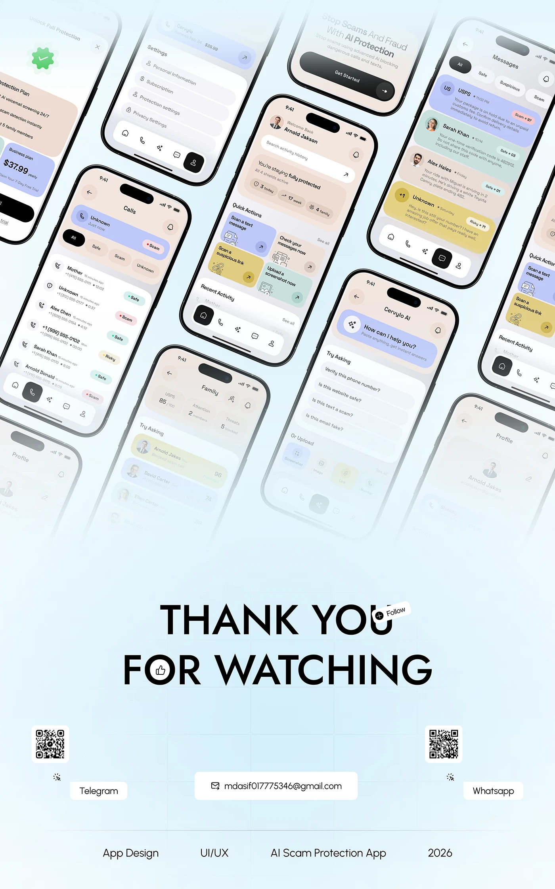

# Tilted Phone Wall with Thank You

**Discipline:** app · **Design type:** Case study closing slide
**Tags:** thanks, tilted-phones, pastel, fade, contact, qr, closing

## What it is
A tall pale-blue slide with a diagonal wall of tilted pastel phone screens fading toward the bottom, then huge 'THANK YOU FOR WATCHING' caps with a Follow chip, two QR codes, contact pills and a footer row of tags.

## What it means
A dense tilted field of screens fades into a bold sign-off, giving a satisfying end to a long story.

## Techniques
- Grid of phones all rotated the same angle
- Progressive fade of the screens into the background
- Huge caps sign-off with a small Follow chip overlapping
- QR codes with platform pills
- Footer row of scope tags

## Best for
- Case-study finales
- Portfolio sign-offs
- Showing many screens at once

## Vocabulary
- **Tilted wall** — Many screens rotated identically and tiled.
- **Fade to background** — Elements losing opacity toward an edge.
- **Contact pill** — A rounded label holding an email or handle.
