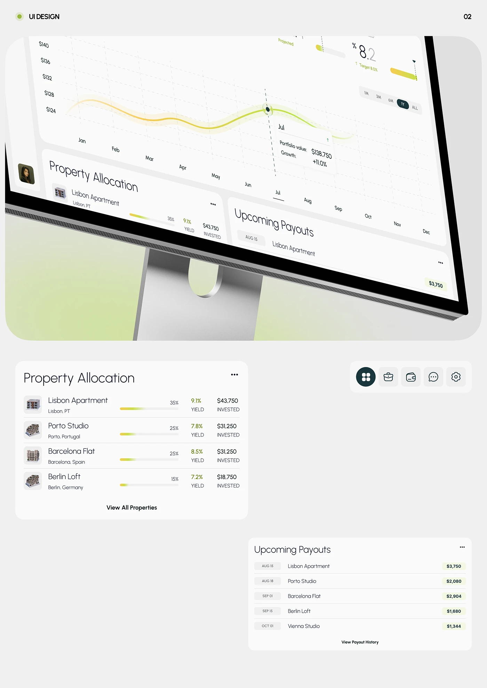

# Tilted monitor with yellow-green glow line chart plus flat allocation and payout cards

**Discipline:** app ·  · **Design style:** Gradient & Aurora
**Tags:** dashboard, real-estate, investment, light-grey, lime, glow-line, monitor, cards

## What it is
A light grey board 'UI Design 02' with a large tilted monitor showing a yellow-to-green glowing chart line with a tooltip, allocation and payout panels, and below flat cards: Property Allocation with thin gradient bars, a nav of round icon buttons with dark green active, and Upcoming Payouts with date pills and amounts.

## What it means
Refined and calm; light type and gradient bars feel like a private wealth app.

## Techniques
- Tilt the monitor to fill the frame.
- Show hero chart as a glowing gradient line.
- Present components flat below as documentation.
- Use date pills and light rules in lists.

## Best for
- Investment dashboard showcases
- Component documentation
- Light green fintech

## Vocabulary
- **Glow line chart** — A chart line with a luminous halo.
- **Allocation bar** — A thin gradient bar showing a share.
- **Date pill** — A small capsule with a date.
- **Component sheet** — A board showing UI parts flat.
