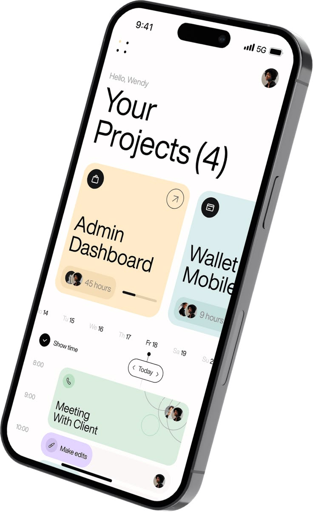

# Tilted Projects and Schedule Phone

**Discipline:** app · **Design type:** Calendar and planner app
**Tags:** projects, schedule, pastel, tilted, cutout, serif-free, cards

## What it is
A cut-out tilted phone on a transparent background showing 'Your Projects (4)' with cream and blue project cards, a date strip and timeline with a green meeting card and a lilac action pill.

## What it means
Big light type and pastel cards feel calm and friendly, and the tilt adds a touch of motion.

## Techniques
- Large light headline with a count
- Pastel colour per project card
- Overlapping avatars and hours captions
- Timeline with a Today marker
- Lilac floating pill for an action

## Best for
- Project and schedule apps
- Isolated device assets for presentations
- Pastel productivity UI

## Vocabulary
- **Cut-out device** — A mockup isolated from any background for reuse.
- **Today marker** — A pill marking the current day on a timeline.
- **Action pill** — A small floating button offering a quick action.
