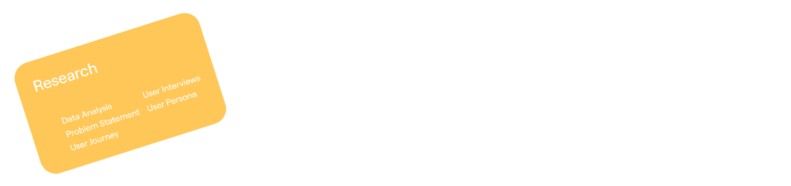

# Tilted yellow rounded card listing research methods on a white field

**Discipline:** app · **Design type:** Process slide
**Tags:** process, research, yellow, tilted-card, white, minimal, animation-frame, labels

## What it is
A wide white canvas with one tilted amber rounded card at the left carrying the word Research and a scattered list: Data Analysis, Problem Statement, User Journey, User Interviews and User Persona.

## What it means
Playful and light; the tilted card feels like a sticky note waiting for companions.

## Techniques
- Tilt a coloured card to break a rigid grid.
- Set list items in two loose columns in white on yellow.
- Leave big white space for other cards to arrive.
- Use the frame as one step of an animated sequence.

## Best for
- Process and methodology slides
- Animated case-study sequences
- Minimal step cards

## Vocabulary
- **Tilted card** — A card rotated slightly for informality.
- **Method list** — A list of activities in a process.
- **Empty canvas** — White space reserved for future elements.
- **Animation frame** — One still from a motion piece.
