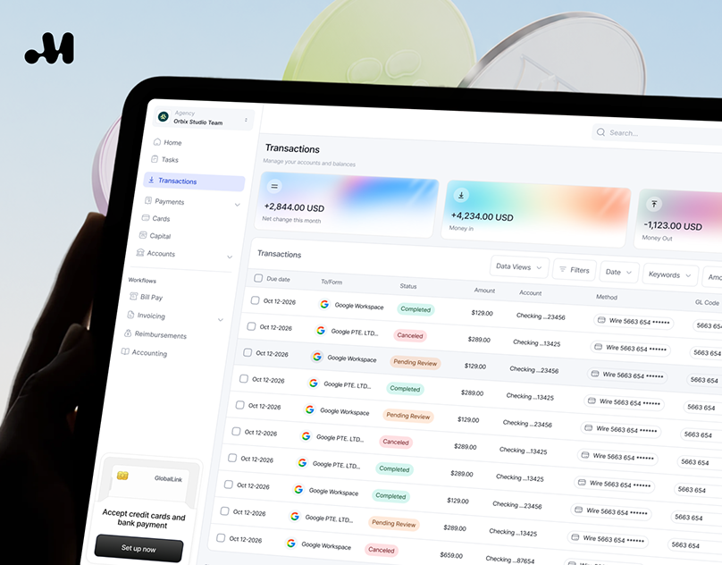

# Fintech transactions table on a tilted tablet held before pastel glass coins, small crop

**Discipline:** app · **Design type:** Device mockup scene
**Tags:** dashboard, fintech, tablet, table, status-pills, gradient-cards, 3d-coins, light-ui

## What it is
A cropped view of a tablet held in a dark hand showing a light transactions dashboard with three gradient summary cards, a filterable table with coloured status pills, against a pale blue sky and translucent lime and clear discs.

## What it means
Clear and modern; glass coins in the sky turn a dense table into something light.

## Techniques
- Tilt a dense dashboard in perspective.
- Use gradient summary cards on top.
- Colour status as soft pills.
- Place translucent 3D discs behind.

## Best for
- Fintech dashboard showcases
- Table-heavy UI presentations
- Pastel glass 3D backdrops

## Vocabulary
- **Status pill** — A soft-coloured capsule showing state.
- **Gradient summary card** — A card with a blurred colour fill and one metric.
- **Glass disc** — A translucent 3D coin used as decoration.
- **Filter bar** — A row of dropdown filters above a table.
