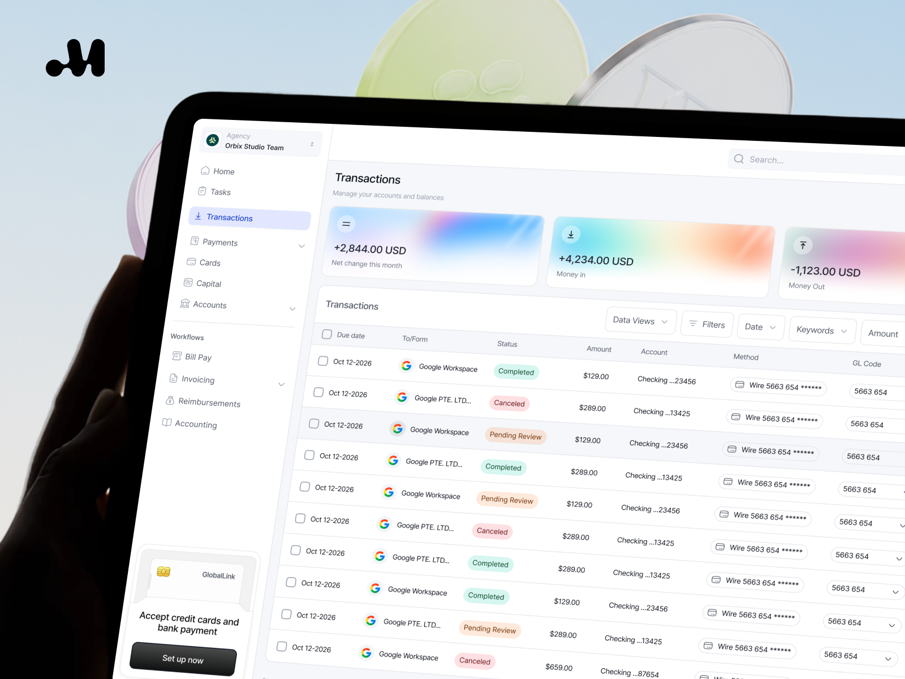

# Full-size tilted tablet with transactions table, gradient summary cards and glass coins

**Discipline:** app · **Design type:** Device mockup scene
**Tags:** dashboard, fintech, tablet, table, status-pills, gradient-cards, 3d-coins, monogram-logo

## What it is
A large tilted tablet on pale blue sky with a sidebar (Home, Tasks, Transactions selected, Payments...), three gradient cards for net change, money in and money out, a table with Google entries, status pills and method chips, and a black 'M' logo at the corner.

## What it means
Efficient and friendly; pastel gradients soften a finance table.

## Techniques
- Tilt the device to fill the frame.
- Highlight the active nav item in lilac.
- Use blurred rainbow gradients for summary tiles.
- Add a small logo in the corner.

## Best for
- Fintech and agency dashboard covers
- Table UI showcases
- Light SaaS products

## Vocabulary
- **Active nav highlight** — A tinted row marking the current page.
- **Method chip** — A small outlined pill naming a payment method.
- **Corner monogram** — A studio logo in a corner.
- **Tilted tablet** — A tablet shown at a steep angle.
