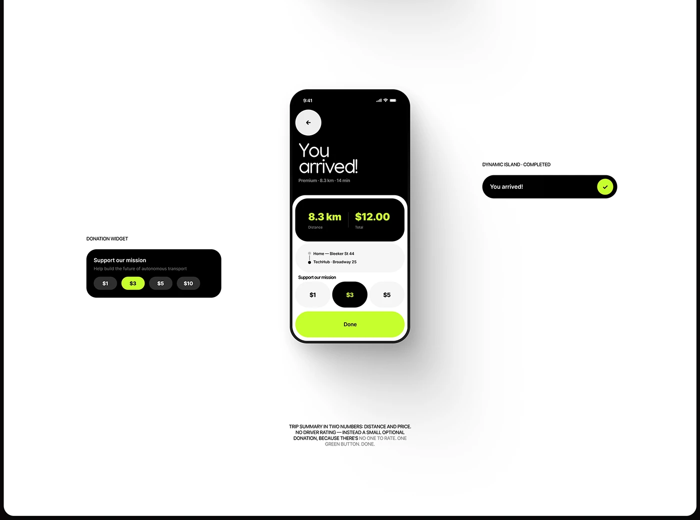

# Black-and-white 'You arrived!' screen with lime stats, donation chips and a completed pill

**Discipline:** app ·  · **Design style:** Dark & Neon
**Tags:** ride, trip-summary, lime, black, white, donation, dynamic-island, annotation

## What it is
A white board with a centred phone: a black header 'You arrived!', a black stat block with lime distance and total, route rows, donation chips ($1, selected $3, $5) and a lime Done button, flanked by a black donation widget and a black 'You arrived!' pill with a lime check, plus a small explanation text.

## What it means
Calm and decisive; two numbers and one button end the trip.

## Techniques
- Show the summary as two big lime numbers.
- Offer donation chips instead of ratings.
- Show the same state as a widget and island pill.
- Explain the logic in a caption.

## Best for
- Ride and delivery completion screens
- Micro-donation UI
- Component showcases

## Vocabulary
- **Completion screen** — A screen confirming a task is done.
- **Donation chips** — Selectable amounts as pills.
- **Island pill** — A Dynamic Island activity state.
- **Design rationale** — A short note explaining a choice.
