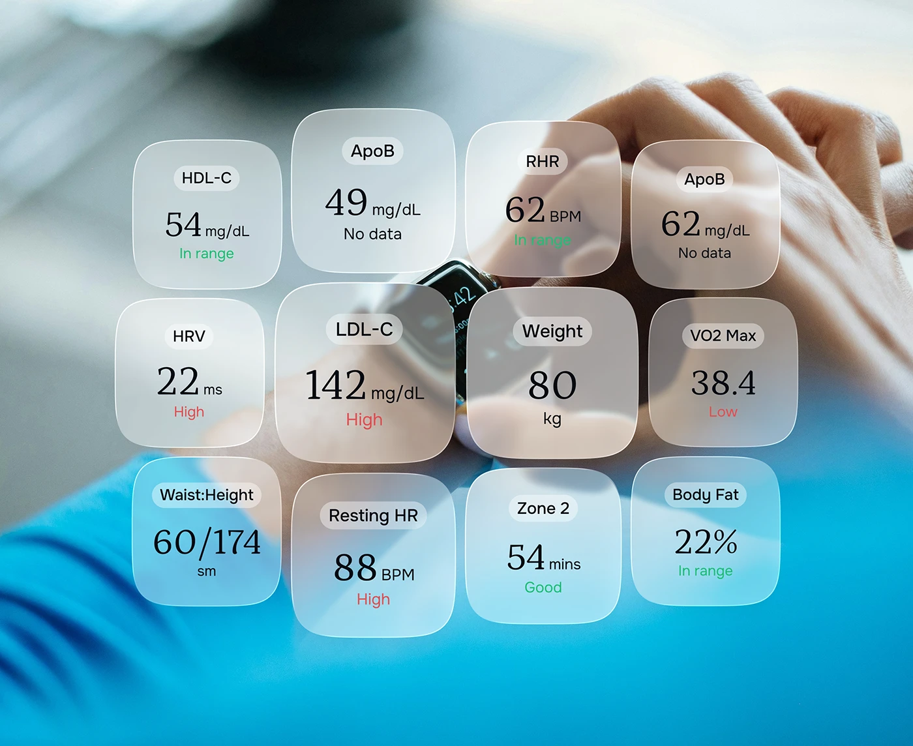

# Grid of frosted glass metric tiles with serif numerals over a blurred wrist-watch photo

**Discipline:** app ·  · **Design style:** Glassmorphism
**Tags:** health, glass, serif-numerals, metrics, blue, watch, status-colours, tiles

## What it is
A blurred photo of a wrist with a smartwatch on a blue background overlaid with twelve frosted rounded tiles (HDL-C, ApoB, RHR, HRV, LDL-C, Weight, VO2 Max, Waist:Height, Resting HR, Zone 2, Body Fat), each with a pill label, a serif numeral, a unit and a green or red status word.

## What it means
Calm and personal; glass tiles turn lab data into a friendly constellation.

## Techniques
- Scatter glass tiles at varied sizes over a photo.
- Set numerals in serif.
- Colour status words green or red.
- Label with a small grey pill.

## Best for
- Health data visuals
- Glass UI showcases
- Wearable app marketing

## Vocabulary
- **Glass tile** — A frosted rounded tile with a metric.
- **Status word** — A green or red word saying in range or high.
- **Label pill** — A small capsule naming a metric.
- **Photo backdrop** — A blurred photo behind UI.
