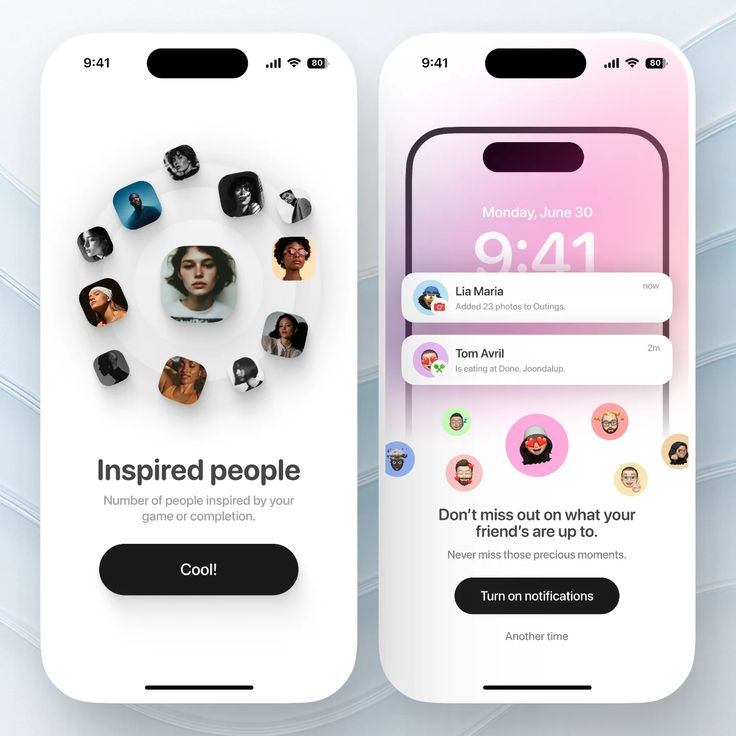

# Orbiting Avatars and Notification Prompt

**Discipline:** app · **Design type:** Onboarding screens
**Tags:** onboarding, avatars, orbit, notifications, memoji, pink, white

## What it is
Two white phones on a pale blue swirl background: an 'Inspired people' screen with rounded portrait tiles orbiting a centre portrait and a black Cool! button, and a lock-screen screen with notification cards, floating memoji and a black 'Turn on notifications' button.

## What it means
Orbiting avatars make a number feel social, and the floating memoji bring the notification prompt to life.

## Techniques
- Portraits arranged on a ring around a central one
- Floating memoji circles above the prompt
- Pink gradient lock screen inside the phone
- Large black pill buttons as the single action
- Notification cards overlapping the mock lock screen

## Best for
- Onboarding and permission screens
- Social apps
- Playful prompt design

## Vocabulary
- **Orbit layout** — Items arranged in a ring around a centre.
- **Permission prompt** — A screen asking the user to allow a feature like notifications.
- **Memoji** — A personalised cartoon avatar.
