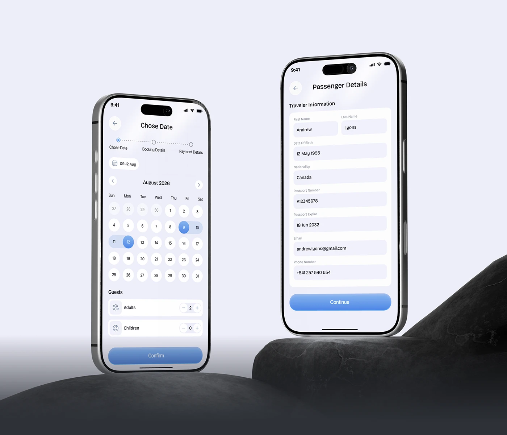

# Calendar and Passenger Form Phones on Rock

**Discipline:** app ·  · **Design style:** 3D & Surreal
**Tags:** calendar, form, booking, rock, lavender, blue, two-phones

## What it is
A pale lavender scene with two phones standing at different heights, one showing a date range picker with guest counters and a Confirm button, the other a passenger details form with a blue Continue button, resting on black rock formations.

## What it means
Dark rock gives the pale UI a strong base, and offset heights make the two-screen flow dynamic.

## Techniques
- Phones on different heights of rock
- Range selection with a blue gradient pill
- Step tracker above the calendar
- Rounded input fields on a white card
- Blue gradient primary buttons

## Best for
- Booking flow screens
- Two-phone hero compositions
- Pale UI with dark props

## Vocabulary
- **Range picker** — A calendar for selecting start and end dates.
- **Guest counter** — A stepper for the number of guests.
- **Offset pair** — Two devices placed at different heights.
