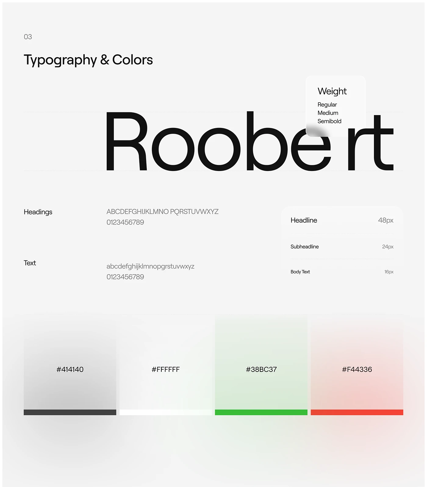

# Roobert specimen with a frosted weight card and blurred-glow colour swatches

**Discipline:** app · **Design type:** Typography and colour guide
**Tags:** typography, colour-palette, grey, glass-card, glow-swatches, green, red, fintech

## What it is
A light grey page '03 Typography & Colors' with a giant 'Roobert' partially covered by a frosted weight card, heading and text alphabets, a size table (48/24/16px) and four swatches (dark grey, white, green, red) each with a soft glow above a solid bar.

## What it means
Elegant and precise; frosted overlays and glows soften guidelines.

## Techniques
- Overlap a glass card on a giant specimen word.
- Show swatches as glow over a solid bar.
- List sizes in a small table card.
- Keep the page pale grey.

## Best for
- Design system typography and colour pages
- Fintech guidelines
- Glass-style documentation

## Vocabulary
- **Glow swatch** — A colour sample with a soft bloom.
- **Size table** — A list of type sizes for each role.
- **Specimen overlap** — A UI card overlapping a type sample.
- **Alphabet lines** — Rows showing all letters and numerals.
