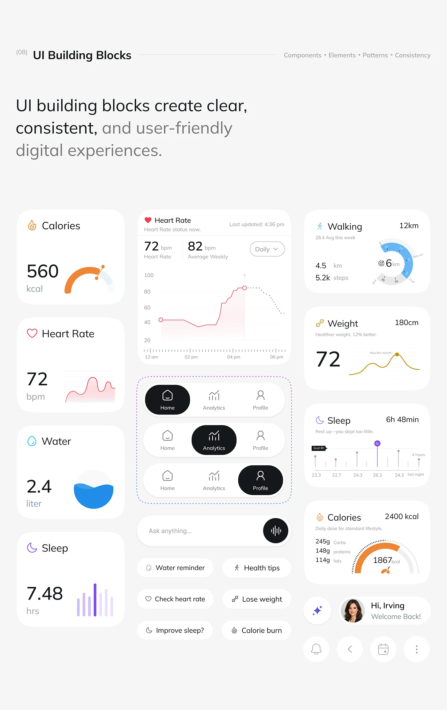

# UI Building Blocks Sheet for a Health App

**Discipline:** app · **Design type:** UI components
**Tags:** ui-kit, health, cards, nav-bar, chips, white, components

## What it is
A pale sheet titled UI Building Blocks with a headline and a grid of components: metric cards (calories, heart rate, water, sleep, walking, weight), a large heart-rate chart, three nav bar states with a black active tab, an ask-anything input, suggestion chips, greeting pill and round icon buttons.

## What it means
Showing all pieces with their states proves consistency, and one chart style per metric keeps each card clear.

## Techniques
- Three nav states with the black pill moving
- Each metric with its own mini chart
- Dashed outline grouping the nav variants
- Suggestion chips with tiny icons
- Round icon buttons row

## Best for
- Design-system documentation
- Health app component sheets
- UI kit previews

## Vocabulary
- **Nav state** — A version of a navigation bar with a different active tab.
- **Metric card** — A card showing one measure with a small chart.
- **Building blocks** — Reusable UI pieces that make up screens.
