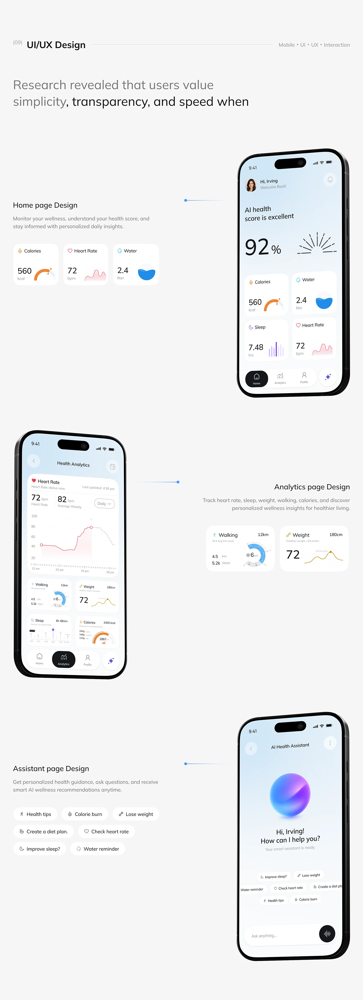

# UI/UX Design Sheet: Home, Analytics and Assistant

**Discipline:** app · **Design type:** UX documentation
**Tags:** health, long-sheet, screens, zigzag, captions, connectors, pale

## What it is
A tall pale sheet titled UI/UX Design with three large phones alternating right, left, right (home, analytics, assistant), each with a heading and description at the opposite side joined by a blue line and small component cards or chips beneath.

## What it means
Alternating placement and blue connectors turn a list of screens into a readable story.

## Techniques
- Zigzag placement of phones
- Blue leader lines with a dot to each caption
- Small extracted component cards below captions
- Large light headline with a bold key phrase
- Extra whitespace between sections

## Best for
- Screen-by-screen design documentation
- Health app case studies
- Long-scroll pages

## Vocabulary
- **Zigzag layout** — Elements alternating sides down a page.
- **Leader line** — A thin line linking a caption to its screen.
- **Extracted component** — A small copy of a UI piece shown beside its screen.
