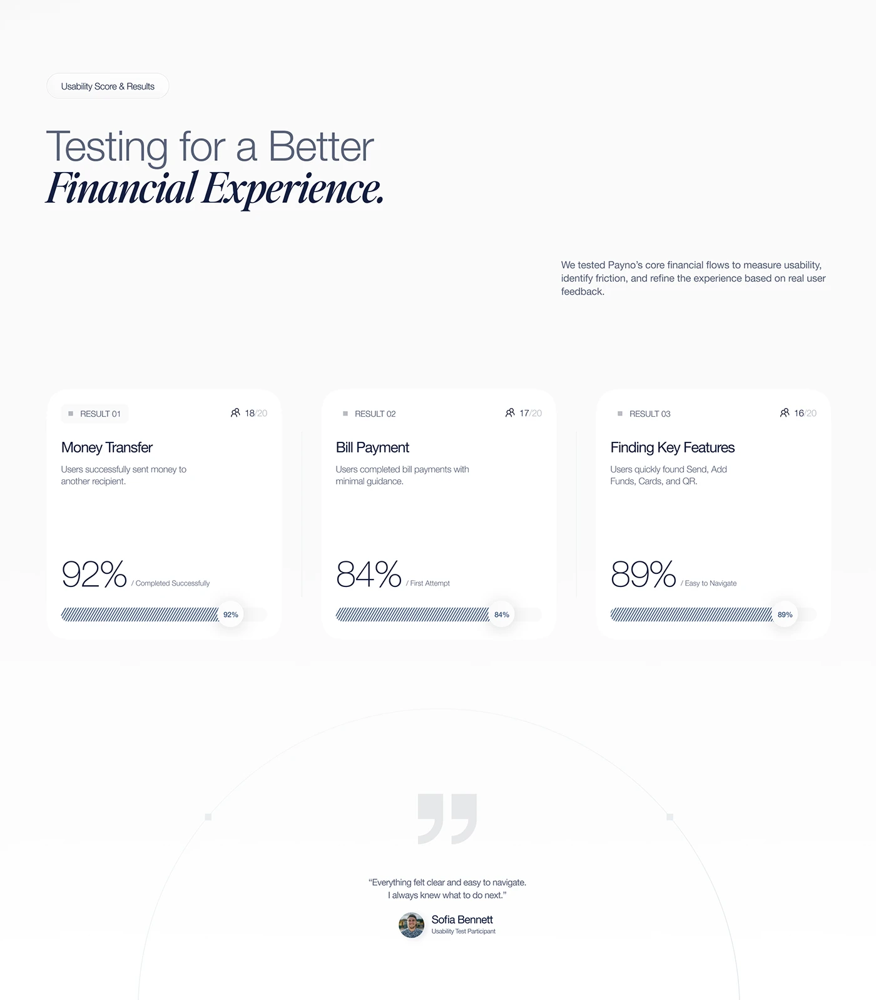

# Usability results: three white cards with big thin percentages and hatched bars, plus a quote inside a hairline arc

**Discipline:** app · **Design type:** Research insight slide
**Tags:** research, usability, white, italic-serif, hatched-bars, quote, fintech, minimal

## What it is
A near-white slide with a pill label, a headline mixing light sans and bold italic serif, three rounded white cards (Money Transfer 92%, Bill Payment 84%, Finding Key Features 89%) each with a thin numeral and a hatched progress bar with a percentage pill, and a large quote mark and testimonial in a huge thin arc.

## What it means
Precise and reassuring; thin numerals and hatched bars feel calm and credible.

## Techniques
- Set percentages in a very thin weight.
- Fill bars with diagonal hatching.
- Frame a quote inside a large hairline arc.
- Mix light sans and bold italic serif.

## Best for
- Usability results slides
- Fintech case studies
- Minimal light decks

## Vocabulary
- **Hatched bar** — A progress bar filled with diagonal lines.
- **Result card** — A card summarising one test outcome.
- **Hairline arc** — A huge thin curve as a frame.
- **Participant quote** — A user's words with name and role.
