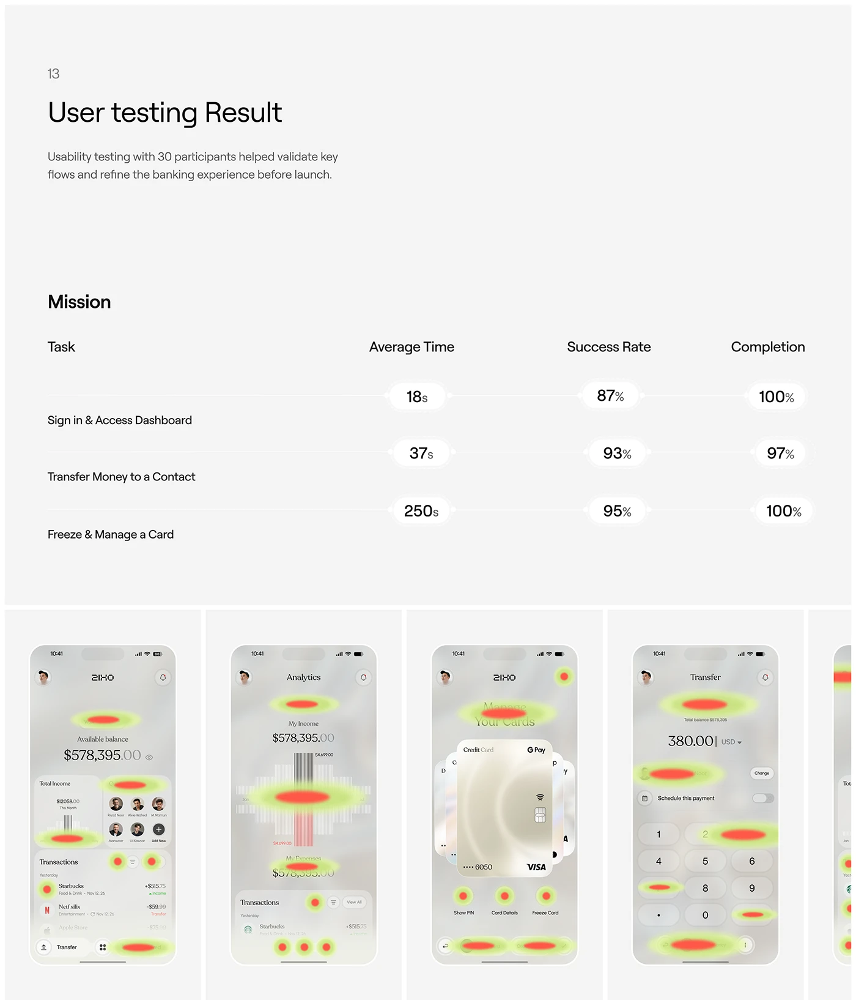

# User-testing results with a task table in floating pills and red-green heatmaps on app screens

**Discipline:** app ·  · **Design style:** Corporate & Clean-Tech
**Tags:** research, usability, heatmap, table, light-grey, pills, fintech, results

## What it is
A pale grey slide '13 User testing Result' with a heading, description, a table of tasks with average time, success rate and completion each in a soft white pill, and below a row of translucent phone screens overlaid with glowing red-to-green heat blobs.

## What it means
Evidence-driven and calm; heat blobs make attention tangible.

## Techniques
- Show metrics as floating white pills on hairlines.
- Overlay red-green blobs as heatmaps on real screens.
- Use plain grey with tiny numerals.
- Present five screens in a row.

## Best for
- Usability results slides
- Heatmap presentations
- Fintech research reports

## Vocabulary
- **Heatmap blob** — A glowing spot showing where users tapped.
- **Metric pill** — A white capsule holding a measure.
- **Mission table** — A list of tasks with results.
- **Overlay analysis** — Data drawn over a UI screenshot.
