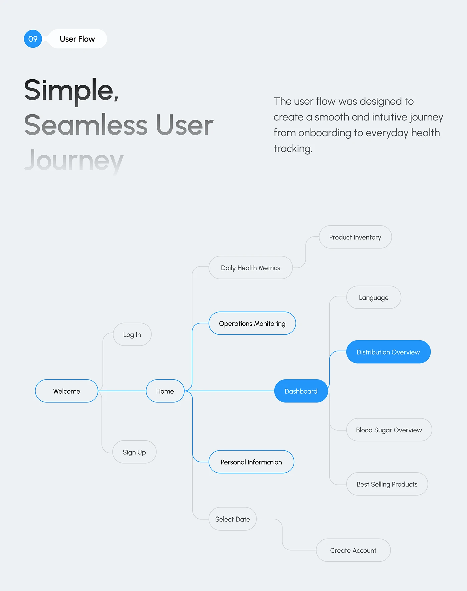

# User Flow Tree with Blue Active Path

**Discipline:** app · **Design type:** UX documentation
**Tags:** user-flow, tree, blue, pills, fading-title, health, grey

## What it is
A pale grey slide with a numbered User Flow pill, a headline fading from dark to light 'Simple, Seamless User Journey', a paragraph, and a left-to-right tree of pills where the main path (Welcome, Home, Dashboard, Distribution Overview) is outlined or filled in blue and other nodes are grey.

## What it means
A blue path through grey nodes shows the happy path at a glance, and the fading title gives depth.

## Techniques
- Blue outlines and fills for the main path
- Grey pills for secondary screens
- Elbow connectors from a central hub
- Headline fading line by line
- Filled blue pills for the key destinations

## Best for
- User flow documentation
- Health-tech case studies
- Highlighting a main route

## Vocabulary
- **Happy path** — The ideal route a user takes through a flow.
- **Hub node** — A node from which several branches leave.
- **Fading headline** — A headline whose lines lose contrast as they descend.
