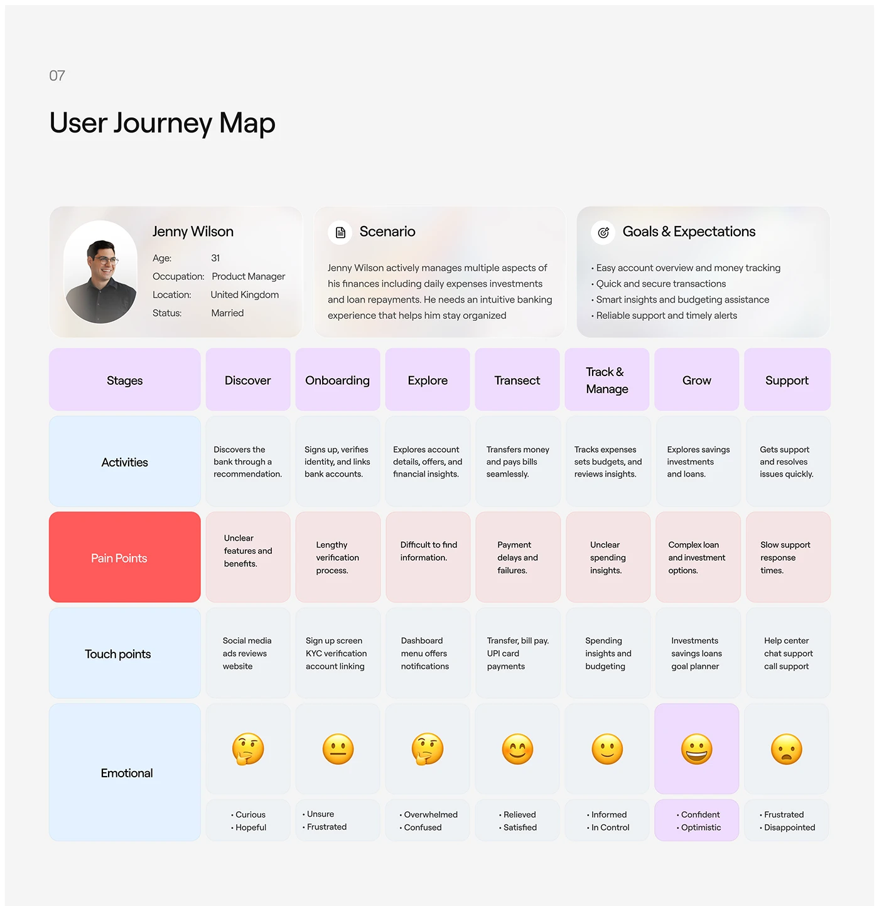

# User journey map: persona, scenario, goals and an eight-stage grid of activities, pain points, touchpoints and emoji emotions

**Discipline:** app ·  · **Design style:** Playful & Illustrated
**Tags:** journey-map, research, persona, pastel, grid, emoji, red, documentation

## What it is
A light grey board '07 User Journey Map' with three frosted cards (Jenny Wilson persona, Scenario, Goals and Expectations) above a grid of eight lilac stage headers (Discover to Support) and rows for Activities (blue), Pain Points (red row header with pink cells), Touch points (blue) and Emotional with emoji faces and words, where the most positive stage is highlighted in lilac.

## What it means
Clear and humane; colour-coded rows and emojis make a journey scannable.

## Techniques
- Colour-code rows: blue for facts, red for pain.
- Use emoji for emotional state.
- Highlight the best moment in lilac.
- Frost the persona cards on top.

## Best for
- UX journey mapping slides
- Banking case studies
- Research documentation

## Vocabulary
- **Journey map** — A grid of stages, actions and feelings.
- **Stage header** — A label at the top of each phase.
- **Emotion row** — A row showing feeling with emoji.
- **Highlighted stage** — One column emphasised in a different colour.
