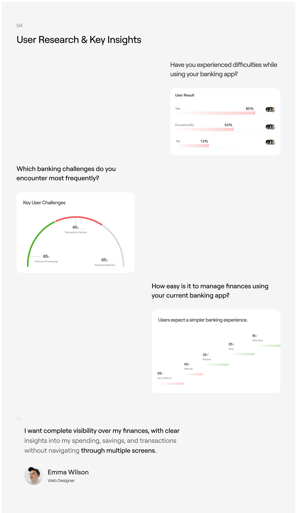

# User research slide with soft-fade bars, a semicircle gauge and a step chart

**Discipline:** app ·  · **Design style:** Corporate & Clean-Tech
**Tags:** research, charts, fintech, light-grey, gauge, step-chart, quote, case-study

## What it is
A light-grey case-study page with question headings and three white chart cards: horizontal bars fading to pink, a semicircle gauge with green, red and grey segments, and a staircase chart. It ends with a user quote and avatar.

## What it means
Analytical but gentle; the fading gradients make data feel soft rather than harsh.

## Techniques
- Fade chart bars to transparency for a light, airy data look.
- Ask the survey question as a heading above each chart card.
- Use uncommon chart shapes (semicircle, staircase) to add interest.
- Close with a highlighted user quote.

## Best for
- UX case studies
- Research summaries
- Fintech presentations

## Vocabulary
- **Gauge chart** — A semicircular chart with segments.
- **Step chart** — A chart where values step up or down like stairs.
- **Soft-fade bar** — A bar with a gradient that fades out.
- **Survey question heading** — Using the actual question as a chart title.
