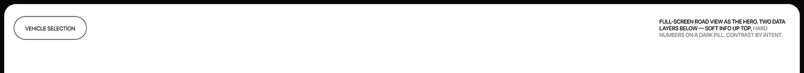

# Rounded white strip with an outlined 'Vehicle selection' pill and a caption on contrast by intent

**Discipline:** app · **Design type:** Case study divider
**Tags:** divider, white, outlined-pill, caption, black-frame, two-tone-text, minimal, case-study

## What it is
A slim white panel with rounded top corners on black, an outlined pill 'VEHICLE SELECTION' at the left and an uppercase caption at the right (some black, some grey) explaining a full-screen road hero with soft info up top and hard numbers on a dark pill.

## What it means
Quiet and explanatory; the caption states the design rule in one line.

## Techniques
- Label the next screen with an outlined pill.
- Explain the design intent in a caption.
- Use two-tone text.
- Frame in black with rounded corners.

## Best for
- Case-study section labels
- Design rationale captions
- Minimal white boards

## Vocabulary
- **Design rationale caption** — A short line explaining a design choice.
- **Section pill** — An outlined capsule naming a section.
- **Contrast by intent** — Deliberately pairing soft and hard elements.
- **Rounded panel** — A panel with softly rounded corners.
