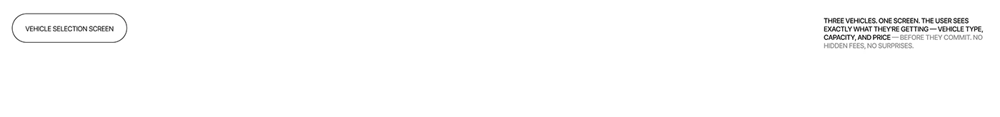

# Wide white strip with an outlined 'Vehicle selection screen' pill and a right-aligned caption

**Discipline:** app ·  · **Design style:** Minimalist
**Tags:** divider, white, outlined-pill, caption, two-tone-text, minimal, case-study

## What it is
A thin white strip with an outlined pill 'VEHICLE SELECTION SCREEN' at the left and a small uppercase caption at the right, part black and part grey, explaining three vehicles on one screen.

## What it means
Quiet and explanatory; a divider that names the next screen.

## Techniques
- Label a section with an outlined pill.
- Set a caption in two tones.
- Keep everything tiny on white.
- Use as a chapter divider.

## Best for
- Case-study section dividers
- Screen labelling
- Minimal white boards

## Vocabulary
- **Screen label** — A pill naming the screen shown below.
- **Two-tone caption** — Text half black half grey.
- **Divider strip** — A slim band separating sections.
- **Micro caps** — Very small uppercase text.
