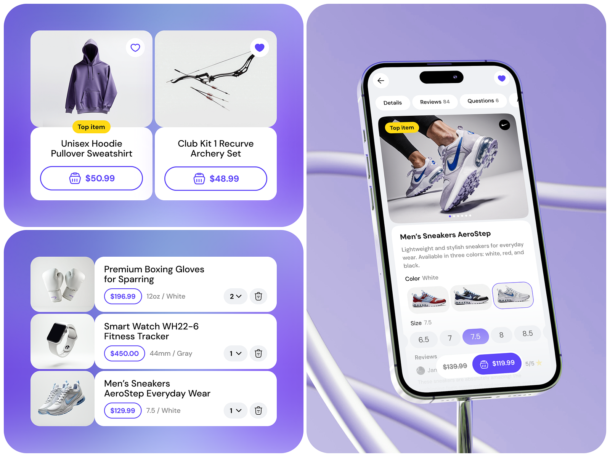

# Violet Shopping Cards, Cart and Product Detail

**Discipline:** app ·  · **Design style:** 3D & Surreal
**Tags:** e-commerce, violet, cards, cart, product-detail, chrome-ribbons, white

## What it is
A violet gradient board of rounded panels: two product cards with heart and price buttons, a cart list with quantity dropdowns and delete buttons, and a phone showing a sneaker detail with colour and size chips and a price button, with chrome ribbons behind.

## What it means
Pale product photos on white cards pop against the violet gradient, and one purple accent unifies actions.

## Techniques
- Outlined price buttons on product cards
- Violet selected states for size and heart
- Chrome ribbon loops behind the phone
- Top-item yellow sticker as a highlight
- Grey image tiles for product cutouts

## Best for
- Shopping app UI showcases
- E-commerce component sets
- Gradient-backed product cards

## Vocabulary
- **Price button** — A button that shows the price and adds to cart.
- **Top item badge** — A yellow tag marking a featured product.
- **Quantity dropdown** — A compact selector to change item count.
