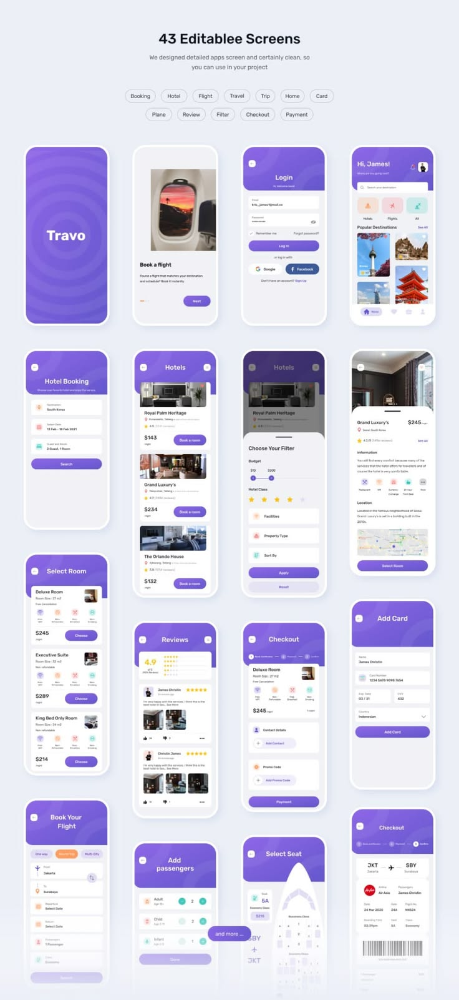

# Violet Travel UI Kit Overview

**Discipline:** app ·  · **Design style:** Geometric & Bauhaus
**Tags:** ui-kit, violet, travel, screens, booking, tags, flat

## What it is
A tall pale sheet titled '43 Editable Screens' with tag chips (Booking, Hotel, Flight...) above a grid of flat violet-and-white app screens: splash, onboarding, login, home, hotel booking, lists, filters, reviews, checkout, seat select and tickets.

## What it means
A dense grid with an obvious count sells completeness, and a single violet keeps the kit unified.

## Techniques
- Headline states the quantity of content
- Category tag chips summarising coverage
- Uniform grid of full screens with consistent headers
- Violet header blocks with white content cards
- Fade at the bottom with an 'and more' pill

## Best for
- UI kit product listings
- Template marketplaces
- Showing an entire app flow at a glance

## Vocabulary
- **Screen grid** — A grid showing many app screens together.
- **Coverage tags** — Chips listing the topics a kit includes.
- **Fade-out tail** — A gradual fade at the end hinting at more content.
