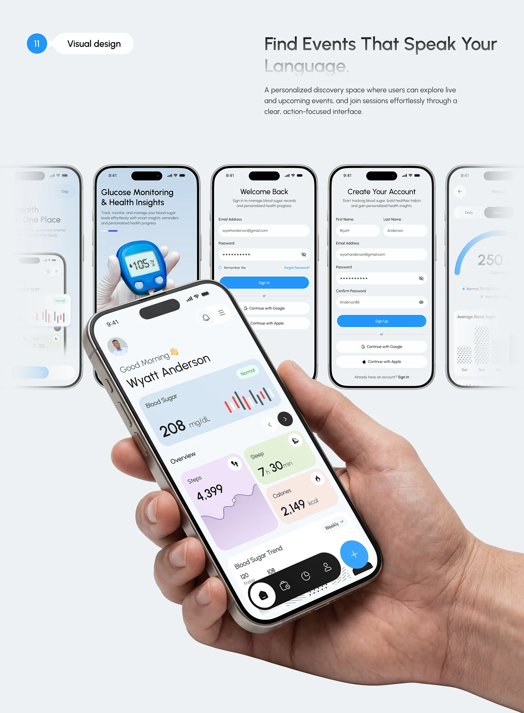

# Hand-Held Health Home over Faded Screens

**Discipline:** app ·  · **Design style:** Gradient & Aurora
**Tags:** health, hand, tilted, screens, fade, blue, auth, visual-design

## What it is
A pale slide with a numbered Visual design pill, a headline about finding events, a row of five phones (onboarding, login, sign up, reports) fading at the edges and a large tilted hand-held phone in front showing a blood sugar home with pastel metric cards.

## What it means
The large hand-held phone breaks the row of screens for a focal moment, and faded edges add depth.

## Techniques
- Large tilted phone overlapping a row
- Edge fade on the outer screens
- Hand holding the front phone
- Pastel metric cards in blue, lilac, green and peach
- Blue gradient pills on auth screens

## Best for
- Health app visual design slides
- Screen row plus hero compositions
- Onboarding and dashboard overviews

## Vocabulary
- **Overlap hero** — A large device overlapping a row of smaller ones.
- **Edge fade** — Outer items fading to suggest continuation.
- **Metric card** — A pastel card showing one health measure.
