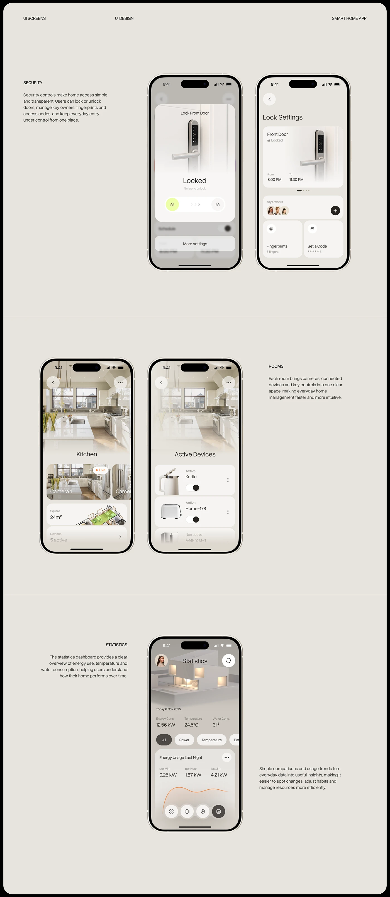

# Beige Smart-Home Security, Rooms and Statistics Sheet

**Discipline:** app · **Design type:** UX documentation
**Tags:** smart-home, beige, screens, lock, rooms, statistics, captions, rounded-frame

## What it is
A tall warm beige sheet in a rounded frame with header labels and three sections, Security (locked door and lock settings), Rooms (kitchen and active devices) and Statistics (energy use), each with phones and a short caption at the side, divided by hairlines.

## What it means
Photographic headers and warm neutral UI make a technical topic homely, and repeated section structure keeps it tidy.

## Techniques
- Three sections separated by hairlines
- Phone pairs with captions alternating sides
- Photographic headers inside screens fading to cream
- Lime highlight on the unlock control
- Orange line chart as a single accent

## Best for
- Smart-home screen documentation
- Warm neutral case studies
- Section-by-section app presentations

## Vocabulary
- **Section divider** — A hairline separating sections of a page.
- **Photo header** — A photograph at the top of a screen fading into the UI.
- **Swipe control** — A slider that completes an action when dragged.
