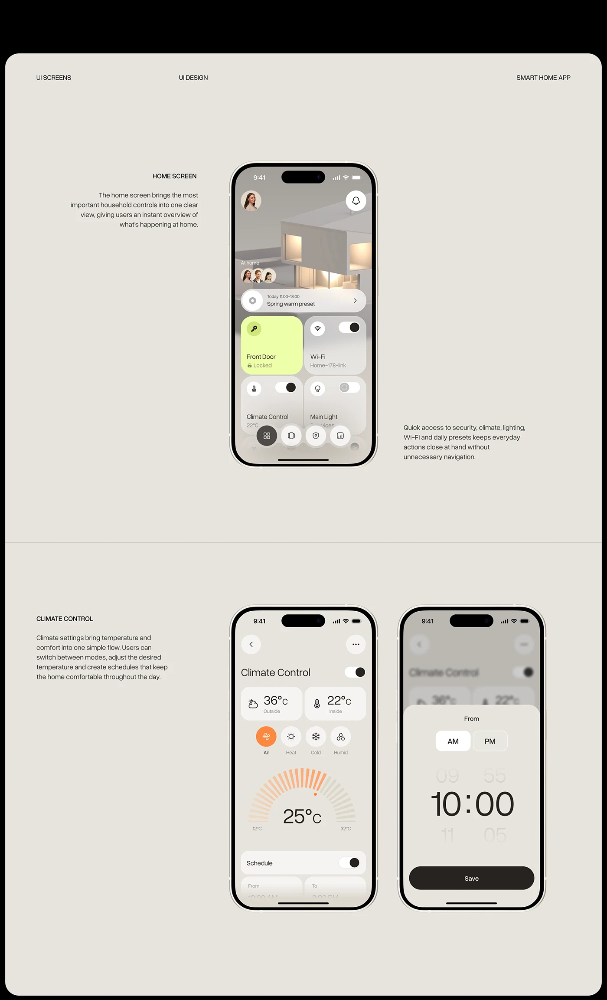

# Warm Grey Smart-Home Screens with Descriptions

**Discipline:** app ·  · **Design style:** Warm & Organic
**Tags:** smart-home, warm-grey, screens, descriptions, climate, time-picker, documentation

## What it is
A tall warm-grey page inside a rounded frame with header labels, a home screen phone with a description at each side, and a climate control phone beside a time-picker sheet, each section captioned in small type.

## What it means
Warm beige feels calm and domestic, and short captions beside each screen make documentation effortless.

## Techniques
- Small caption blocks left and right of each phone
- Section title in caps
- Warm grey and cream UI on a warm grey page
- Orange as the only accent
- Rounded frame containing the page

## Best for
- Screen documentation
- Smart-home UI presentations
- Calm neutral case studies

## Vocabulary
- **Screen caption** — A short paragraph explaining a nearby screen.
- **Time picker sheet** — A bottom sheet with scroll columns to choose a time.
- **Warm neutral** — A beige or greige used as a base colour.
